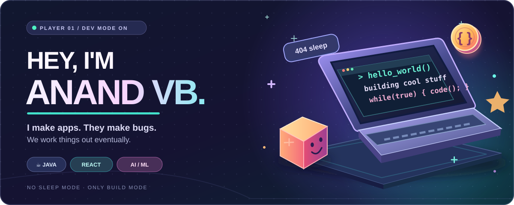

<div align="center">



### 🎮 HELLO, INTERNET! I’m Anand VB 👾

**Java + full-stack + AI/ML** · B.Tech AI & Data Science @ SKCT '27

*Professional bug creator. Part-time bug remover. Full-time curious human.*

[](https://anand-vb.vercel.app/)
[](https://www.linkedin.com/in/anand-v-b-4868352b4/)
[](https://github.com/AnandVB07?tab=repositories)

</div>

---

### 🕹️ CURRENT PLAYER STATUS

```text
NAME          Anand VB
CLASS         Java Dev / Full-Stack / AI Explorer
MAIN QUEST    Become a better software engineer
SIDE QUEST    Build fun products that actually work
XP            400+ DSA problems practiced
ACHIEVEMENT   "It works on my machine" 🏆
BOSS FIGHT    That one edge case
```

### 🛸 STUFF I'VE BUILT (instead of sleeping)

<table>
<tr>
<td width="50%" valign="top">
<h3>📈 <a href="https://github.com/AnandVB07/zenBull">ZenBull / ValraNow</a></h3>
<p><b>The finance spaceship.</b><br/>Investment research, trading simulations, portfolio tracking and risk workflows.</p>
<code>React</code> <code>FastAPI</code> <code>Python</code>
</td>
<td width="50%" valign="top">
<h3>🔮 <a href="https://github.com/AnandVB07/ChurnIQ">ChurnIQ</a></h3>
<p><b>Customer crystal ball (with math).</b><br/>Predicts churn risk and explains model signals for retention decisions.</p>
<code>XGBoost</code> <code>SHAP</code> <code>React</code>
</td>
</tr>
<tr>
<td width="50%" valign="top">
<h3>✈️ <a href="https://github.com/AnandVB07/AtlasUla">AtlasUla</a></h3>
<p><b>Trip planning without 37 open tabs.</b><br/>AI-assisted itineraries, budgets and travel planning.</p>
<code>React</code> <code>TypeScript</code> <code>Express</code>
</td>
<td width="50%" valign="top">
<h3>🌱 <a href="https://github.com/AnandVB07/Krishigo">KrishiGo</a></h3>
<p><b>Farming knowledge, game mode ON.</b><br/>Gamified agricultural learning with activities and rewards.</p>
<code>React Native</code> <code>Firebase</code>
</td>
</tr>
</table>

<div align="center">

**More builds:** [🍔 Foodie](https://github.com/AnandVB07/Foodie) · [🛒 GreenMart](https://github.com/AnandVB07/GreenMart) · [🎬 My Portfolio](https://github.com/AnandVB07/AnandPortfolio)

</div>

### 🧰 MY INVENTORY

<table>
<tr><td>⚔️ <b>Main weapons</b></td><td>Java · Python · JavaScript · SQL · DSA</td></tr>
<tr><td>🎨 <b>UI magic</b></td><td>React · HTML · CSS · Vite</td></tr>
<tr><td>🧪 <b>Backend potions</b></td><td>FastAPI · Node.js · Express · REST APIs</td></tr>
<tr><td>🧠 <b>AI toolkit</b></td><td>pandas · scikit-learn · XGBoost · SHAP</td></tr>
<tr><td>💾 <b>Save points</b></td><td>SQLite · MySQL · Firebase</td></tr>
<tr><td>🔧 <b>Dev gear</b></td><td>Git · GitHub · Docker · Postman · Vercel</td></tr>
</table>

### 📊 STATS SCREEN

<div align="center">


</div>

> *“I have two moods: adding features and fixing what adding features broke.”* 🫠

<div align="center">

### 🚀 THE NEXT LEVEL IS LOADING...

**Open to software engineering opportunities, interesting projects, and friendly tech conversations.**

[🌍 Visit the portfolio](https://anand-vb.vercel.app/) · [💬 Connect on LinkedIn](https://www.linkedin.com/in/anand-v-b-4868352b4/)

<sub>Made with code, caffeine, and an unreasonable number of browser tabs. ☕</sub>

</div>
