&nbsp;

&nbsp;

---

  

## 💻 Tech Stack

  

## 📊 GitHub Analytics

  
  Automatically refreshed from GitHub every 6 hours. Scheduled updates may be delayed by GitHub Actions.

---

<!-- Clean live project and goals panels; generated by GitHub Actions using GitHub API data. -->

<a href="https://codolio.com/profile/anandvb07/">DSA Practice</a> &nbsp;·&nbsp;
<a href="https://github.com/AnandVB07/AnandPortfolio">Portfolio</a> &nbsp;·&nbsp;
<a href="https://github.com/AnandVB07/zenBull">FinTech Project</a> &nbsp;·&nbsp;
<a href="https://github.com/AnandVB07/ChurnIQ">ChurnIQ</a>

Repository data refreshes automatically, usually every 6 hours. Interests and 2026 goals are personal targets, not automatically measured progress.

---

## 🌐 Connect With Me

  

  

  

  

⭐ **Code. Create. Build. Repeat.**

