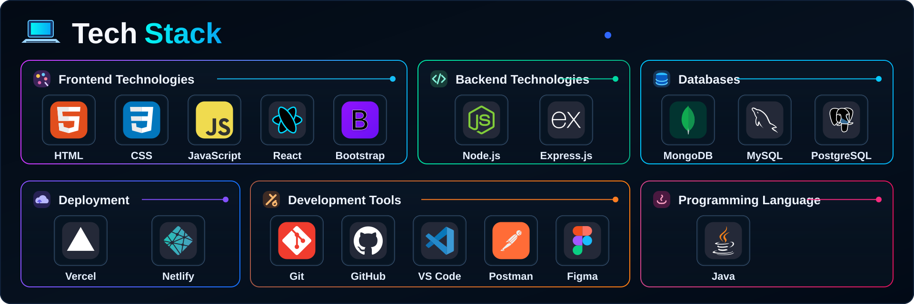
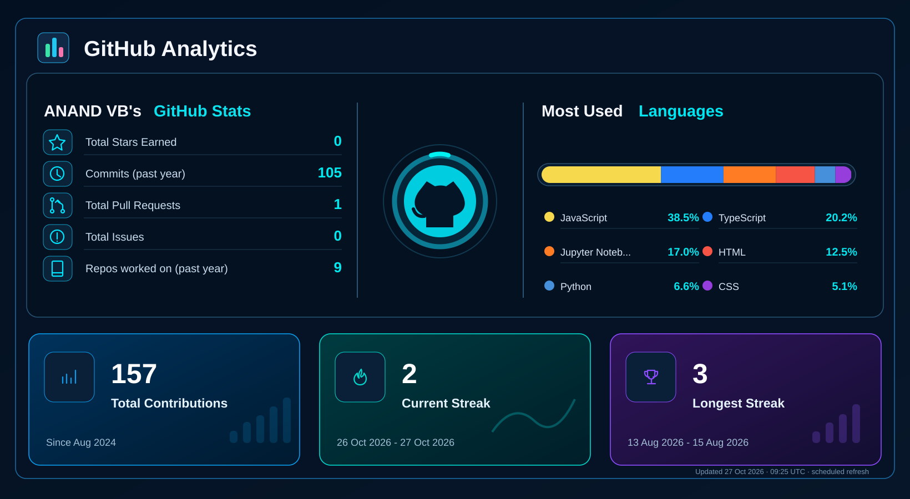
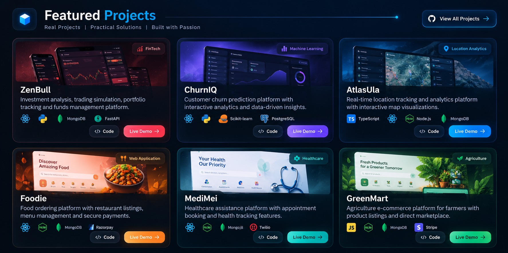

&nbsp;

&nbsp;

---

  

## 💻 Tech Stack

  

## 📊 GitHub Analytics

  
  Automatically refreshed from GitHub every 6 hours. Scheduled updates may be delayed by GitHub Actions.

---

## Featured Projects

<a href="https://github.com/AnandVB07/zenBull">ZenBull</a> &nbsp;·&nbsp;
<a href="https://github.com/AnandVB07/ChurnIQ">ChurnIQ</a> &nbsp;·&nbsp;
<a href="https://github.com/AnandVB07/AtlasUla">AtlasUla</a> &nbsp;·&nbsp;
<a href="https://github.com/AnandVB07/Foodie">Foodie</a> &nbsp;·&nbsp;
<a href="https://github.com/AnandVB07/MediMei">MediMei</a> &nbsp;·&nbsp;
<a href="https://github.com/AnandVB07/GreenMart">GreenMart</a> &nbsp;·&nbsp;
<a href="https://github.com/AnandVB07?tab=repositories">View All Projects →</a>

---

&nbsp;

&nbsp;

&nbsp;

